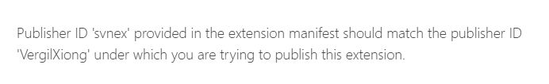

# SVN Blame Hover

在 VS Code 中查看每一行代码的 SVN 提交信息：鼠标悬停即显示**作者、版本号、提交时间、提交日志**，并支持在行尾常驻显示注解（类似 GitLens）。

插件介绍：http://43.155.216.127:3000/fool.html

## 功能截图



[查看贴图原图](https://raw.githubusercontent.com/wrongobject/SVNLineBlame/main/assets/screenshot.png)

## 功能

- **悬停即显示（默认，无需任何菜单/命令）**：鼠标停在某一行上，会**在该行末尾直接显示**该行的提交信息（作者 · r版本号 · 时间），
  同时弹出详情卡片（提交时间 / 相对时间 / commit log）。鼠标移开后自动隐藏。
  插件只在悬停时才执行 svn 查询，不悬停不会有任何 svn 调用与界面占用。
- **选中行显示（默认开启）**：鼠标点击某行、或光标移动到某行，该行末尾即显示其提交信息；框选多行时为选区内每一行都显示。
- **行尾注解（可选，默认关闭）**：开启 `svnBlame.inline.enabled` 后，每行末尾（或仅当前行）常驻显示 `作者 · r版本号 · 3 天前`。
- **状态栏（可选，默认关闭）**：开启 `svnBlame.statusBar.enabled` 后，显示光标所在行的提交摘要，点击可查看完整日志。
- **完整日志**：悬停卡片内或编辑器右键菜单 → `SVN Blame: 查看该行修订的完整日志`，在输出面板展示 `svn log -v` 结果。
- **本地修改识别**：未提交的行标记为「本地未提交」。

## 使用前提

1. 本机安装 SVN 命令行客户端并能执行 `svn --version`。
2. 打开的文件位于 SVN 工作副本内（向上能找到 `.svn` 目录）。

> 若 `svn` 不在 PATH 中，在设置里配置 `svnBlame.svnPath`，例如
> `C:\Program Files\TortoiseSVN\bin\svn.exe`。

## 设置项

| 配置项 | 默认值 | 说明 |
| --- | --- | --- |
| `svnBlame.enabled` | `true` | 总开关 |
| `svnBlame.svnPath` | `svn` | svn 可执行文件路径 |
| `svnBlame.timeout` | `30` | svn 命令超时（秒） |
| `svnBlame.dateFormat` | `YYYY-MM-DD HH:mm` | 日期格式 |
| `svnBlame.inline.enabled` | `false` | 是否常驻显示行尾注解（默认关闭，仅悬停显示） |
| `svnBlame.inline.mode` | `allLines` | `allLines` 所有行 / `currentLine` 仅当前行 |
| `svnBlame.inline.template` | `${author} · r${revision} · ${date}` | 注解模板，可用 `${author}` `${revision}` `${date}`（提交时间）`${relativeTime}` |
| `svnBlame.selection.enabled` | `true` | 点击/光标移动时，在选中行末尾显示提交信息 |
| `svnBlame.statusBar.enabled` | `false` | 状态栏常驻摘要（默认关闭） |
| `svnBlame.hover.inline` | `true` | 悬停时在被悬停的那一行末尾直接显示提交信息 |
| `svnBlame.hover.showCommitMessage` | `true` | 悬停是否显示提交日志 |
| `svnBlame.hover.messageMaxLines` | `20` | 悬停日志最大显示行数 |

## 命令

- `SVN Blame: 切换行内注解显示`
- `SVN Blame: 刷新缓存`
- `SVN Blame: 查看该行修订的完整日志`

## 开发调试

```bash
npm install       # 安装依赖
npm run compile   # 编译到 out/
```

在本工程按 `F5` 启动扩展宿主进行调试（`Run Extension` 配置会自动执行 `npm run watch`）。

## 打包安装

```bash
npm run package   # 生成 svn-blame-hover-0.1.0.vsix
```

安装方式：

- 命令行：`code --install-extension svn-blame-hover-0.1.0.vsix`
- 或 VS Code 扩展面板 → `...` → `Install from VSIX...`

`package.json` 中的 `publisher` 当前为 `svnex`，发布到市场前请改成自己的发布者 ID。

## 实现说明

- 通过 `svn blame --xml -r BASE` 获取每行的 revision / author / date，缓存到内存，文件保存或关闭时失效。
  （不用默认的 WORKING：只要文件有本地修改，svn 就会把所有行都判为未提交。）
- 本地修改通过 `svn diff` 的 unified hunk 计算行号偏移，从而既能正确标记「本地未提交」的行，也能让增/删行之后的行号保持对齐。
- 提交日志通过 `svn log --xml -r <rev>` 获取，并按「工作副本 + revision」缓存，避免重复查询。
- 同一文件同一时刻只会执行一次 blame（pending 去重），失败结果也会被缓存，避免频繁悬停时反复调用 svn。
- 大文件（> 8000 行）不渲染全量行内注解，避免卡顿。
